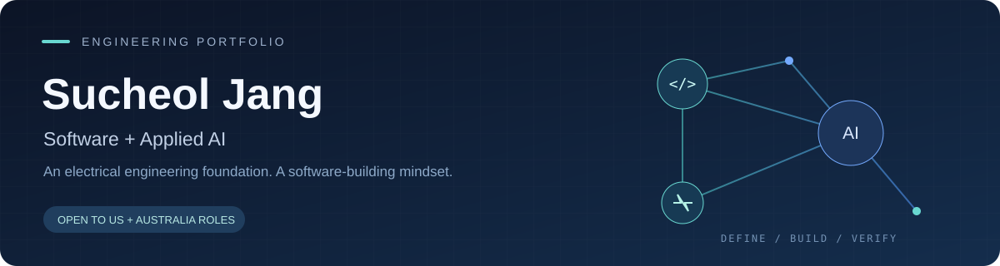

  

  
  
  

## Hi, I'm Sucheol

I'm an **Electrical Engineering graduate building software and applied AI projects at SSAFY**. I enjoy turning an ambiguous problem into clear requirements, working features, and checks that make the result assessable.

My experience connects **software development, AI-assisted workflows, RF research, and embedded systems**. I'm exploring **junior software and backend roles in the United States and Australia**, with additional interests in applied AI, cloud, and electrical engineering.

**Start here:** [Project case studies](#selected-projects) · [Technical experience](#technical-experience) · [Background](#background) · [Contact](#contact)

## Selected projects

### 01 / Everyone's Prompt
**Prompt-based coding practice for junior developers**  
**Role:** PM · SSAFY team project · July–August 2026

How do you check whether AI-generated changes respect an existing codebase? I designed Java challenges and evaluation criteria covering multi-file investigation, normal and boundary behavior, error handling, state preservation, and existing interfaces.

[**Read my contribution →**](portfolio/everyones-prompt.md) · [Team code and architecture](https://github.com/ddingorang/itsourprompt)

### 02 / DdakKok
**AI-assisted ingredient review for child-specific allergy and health profiles**  
**Role:** Frontend lead; product/AI architecture and integration contributor · May–June 2026

I helped connect the product workflow, AI architecture, and frontend experience. Our team received the **Korea Chamber of Commerce and Industry Chairperson's Award** at the **2026 SSAFY × Kakao Tech AI Hackathon**.

[**Read my contribution →**](portfolio/ddakkok.md) · [Frontend repository](https://github.com/peanut-works/ddakkok-web) · [English demo guide](portfolio/ddakkok-frontend-guide.md)

### 03 / Wireless Oxygen Concentration Controller
**An embedded monitoring and wireless-control prototype**  
**Role:** Sensor integration, circuits, programming, and wireless control · Capstone · 2024

Integrated oxygen sensing, circuit design, control logic, and wireless communication. **Silver Prize, 2024 Capstone Design Competition.** Public source and demo materials are not currently linked.

Team repositories show the complete team system. The case studies separate my individual contribution from team implementation. Presentation demos and mock data are identified in the linked guides.

## Technical experience

| Area | Experience |
| :--- | :--- |
| **Languages** | Python · Java · SQL |
| **Backend and data** | Django · REST APIs · PostgreSQL · Docker |
| **Applied AI** | AI-assisted workflows · prompt-based coding challenges · evaluation criteria |
| **Engineering** | Embedded systems · RF plasma etching · impedance matching · PLECS · oscilloscopes |

## Background

**University** — B.Eng. in Electrical Engineering, February 2026  
Minor in New Energy Engineering · Accredited engineering curriculum

**Undergraduate Research Assistant** — University, March 2024–June 2025  
RF plasma etching and impedance matching; PLECS and oscilloscope-based measurement and analysis

**Samsung Software & AI Academy** — Non-degree software and AI training, 2026–present

## Recognition

| Year | Award |
| :--- | :--- |
| **2026** | Korea Chamber of Commerce and Industry Chairperson's Award · SSAFY × Kakao Tech AI Hackathon · DdakKok team |
| **2025** | Major Track Grand Prize · University President's Award · JBNU SW·AI Competition |
| **2024** | Silver Prize · Capstone Design Competition |

## Contact

**Email:** [superstarrypassion@gmail.com](mailto:superstarrypassion@gmail.com)  
**LinkedIn:** [Sucheol Jang](https://www.linkedin.com/in/sucheol-jang-244652361/)  
Based in Seoul, South Korea · Interested in opportunities in the United States and Australia

---

한국어 소개 · 추가 프로젝트 및 학습 기록

# 👋 안녕하세요, 장수철입니다

SSAFY&카카오 해커톤 수상(대한상공회의소회장상) 딱콕

### 사용자 문제를 발견하고, 아이디어를 실제 서비스로 구현하는 Developer & PM

개발뿐만 아니라 서비스 기획, MVP 범위 설정, 사용자 흐름 설계와
팀 프로젝트 운영까지 함께 고민하는 개발자입니다.

현재 SSAFY에서 웹·모바일 개발과 알고리즘을 공부하며
다양한 프로젝트를 통해 실제 서비스를 만드는 경험을 쌓고 있습니다.

 

 

## 🙋‍♂️ About Me

* 💻 개발과 기획을 함께 고민하는 **Developer & PM**
* 🎓 SSAFY에서 웹·모바일 개발 및 알고리즘 학습 중
* 🧩 복잡한 문제를 작은 기능 단위로 나누어 해결하는 것을 좋아합니다.
* 📝 PRD, 기능 명세서, 사용자 흐름, 유스케이스 작성에 관심이 있습니다.
* 🚀 아이디어를 빠르게 MVP로 구현하고 검증하는 과정을 좋아합니다.
* 🤝 팀원들과 적극적으로 소통하며 프로젝트를 완성해 나가는 것을 중요하게 생각합니다.
* 📚 React, React Native, Django, Supabase를 중심으로 공부하고 있습니다.
* 🤖 AI를 활용한 개발과 프롬프트 평가·학습 서비스에 관심이 있습니다.
* 🗣️ 영어 말하기와 일본어를 꾸준히 공부하고 있습니다.

 

# 🛠 Tech Stack & Tools

> 프로젝트에서 사용했거나 현재 학습하고 있는 기술입니다.

## 💬 Languages

  
  
  
  
  
  
  
  
  

## 🎨 Frontend

  
  
  
  
  
  
  
  

## ⚙️ Backend

  
  
  
  
  
  
  

## 🗄️ Database & Storage

  
  
  
  
  
  

## ☁️ Cloud, Deployment & Infrastructure

  
  
  
  
  
  

## 🗺️ Maps & External APIs

  
  
  
  

## 🤖 AI & Development Workflow

  
  
  
  
  
  
  
  

## 🔧 Development Tools

  
  
  
  
  
  
  
  
  
  

## 🎯 Planning, Design & Collaboration

  
  
  
  
  
  
  
  
  
  
  

## 💻 Development Environment

  
  
  

 

# 🚀 Projects

## 🐶 멍백홈

> 유실견의 목격 정보를 시간순 지도에 모아 보호자와 구조 활동가가 빠르게 확인할 수 있도록 돕는 서비스

### 주요 기능

* 실종 사건 생성 및 공개 공유 링크·QR 제공
* 로그인 없이 모바일 웹에서 목격 정보 제보
* 실제 목격 시간을 기준으로 표시되는 타임핀 지도
* 목격 위치, 시간, 사진, 연락처 정보 관리
* 보호자용 앱에서 제보 확인 및 신뢰 상태 관리

### Tech Stack

  
  
  
  
  
  

 

## 🎙️ SoundLens

> 한국인 OPIc 학습자의 발음과 말하기 특성을 분석해 실행 가능한 피드백을 제공하는 AI 학습 서비스

### 주요 기능

* 10개 답변을 기반으로 한 OPIc 예상 등급 분석
* 발음, 강세, 리듬, 연결 발음 피드백
* 사용자 음성을 시각화하는 Sound Map UI
* 원어민과 사용자의 강세를 비교하는 Stress Heatmap
* 자주 틀리는 발음의 입 모양과 혀 위치 안내

### Tech Stack

  
  
  
  
  

 

## ⚾ 야구 구단 추천 서비스

> 사용자의 응원 성향과 선호도를 분석해 어울리는 KBO 구단을 추천하는 서비스

### 주요 기능

* MBTI 형태의 질문을 활용한 구단 추천
* 응원 문화, 지역, 팀 컬러와 경기 스타일 분석
* 구단, 선수, 태그, 질문, 선택지 데이터 모델링
* 추천 결과 및 구단 상세 정보 제공

### Tech Stack

  
  
  
  

 

## 📚 Django Book Service

> Django의 인증과 CRUD 구조를 학습하기 위해 제작한 도서 관리 웹 서비스

### 주요 기능

* 회원가입, 로그인, 로그아웃
* 사용자 프로필 수정 및 회원 탈퇴
* 도서 생성, 조회, 수정, 삭제
* Django ModelForm 기반 데이터 검증
* Bootstrap 기반 반응형 웹 화면

### Tech Stack

  
  
  
  

 

# 📚 Currently Learning

* React 및 React Native의 상태 관리와 렌더링 최적화
* Django REST Framework를 활용한 API 서버 개발
* Supabase 인증, 데이터베이스, 스토리지, Edge Functions
* PostgreSQL과 PostGIS를 활용한 위치 기반 데이터 처리
* 서비스 아키텍처와 도메인 설계
* 사용자 흐름, 유스케이스, 기능 명세서 작성
* 알고리즘과 문제 해결
* AI를 활용한 개발 워크플로
* 프롬프트 작성과 AI 출력 평가
* 영어 말하기와 일본어 회화

 

# 📊 GitHub Stats

 

 

 

# 📫 Contact

* GitHub: [github.com/Apple7575](https://github.com/Apple7575)

 

### 사용자의 문제를 발견하고, 필요한 서비스를 끝까지 구현하는 개발자가 되겠습니다.

 

