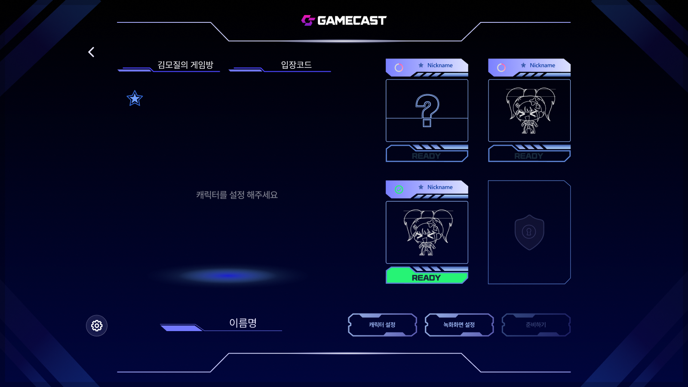
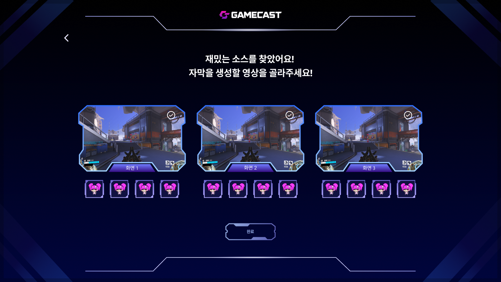
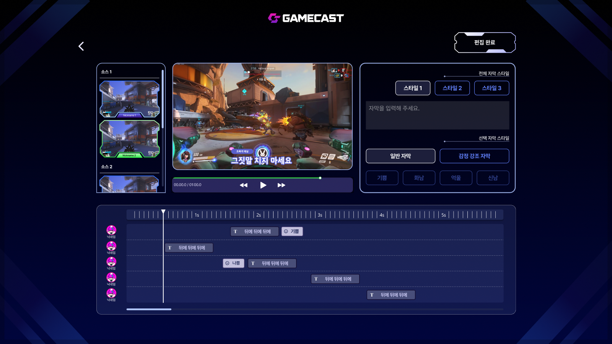
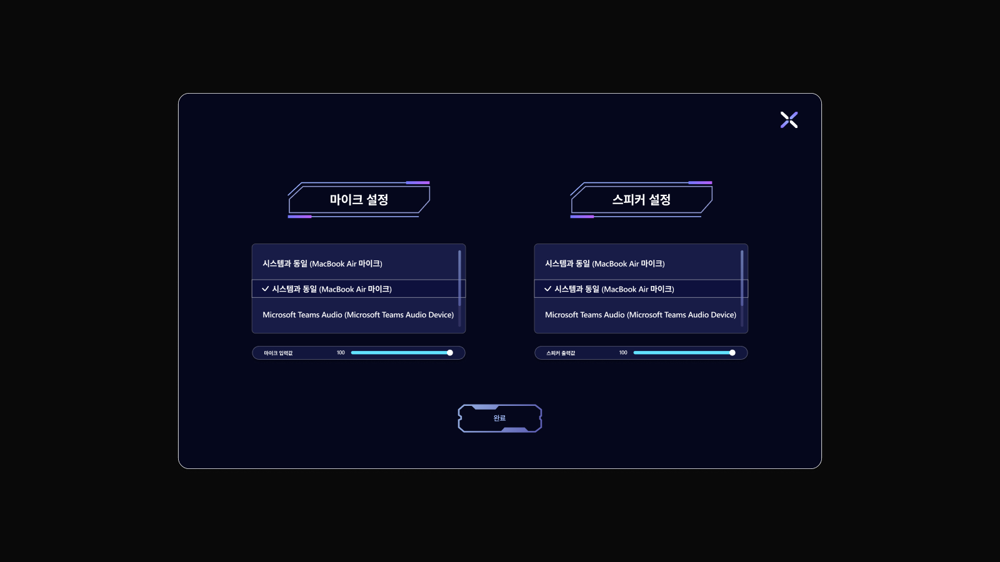

# GameCast — Contribution Case Study

**Project:** UMC-GameCast · team project · July 2025  
**My role:** Frontend contributor and AI media-processing prototype contributor  
[Figma UI design — selected screen](https://www.figma.com/design/RbjgIaC3PpoGiOjXfc5Kz4/UMC-%EA%B2%9C%EC%BC%80?node-id=1002-24458&p=f&t=wh49YQ0i59rwGTYd-0) · [Team web-service repository](https://github.com/UMC-GameCast/gamecast-web-service) · [Server repository](https://github.com/UMC-GameCast/gamecast-server) · [PR #8 — Waiting-room UI and routing](https://github.com/UMC-GameCast/gamecast-web-service/pull/8) · [PR #10 — Highlight and media-processing workflow](https://github.com/UMC-GameCast/gamecast-web-service/pull/10)

## Product

GameCast is a collaborative game-room experience built around creating and joining rooms, coordinating participants, and recording gameplay. The team server documentation describes real-time communication with Socket.IO and WebRTC, recording services, cloud storage, and a separate highlight-processing workflow.

## Selected UI screens

The following screens are from the team's Figma design file. They illustrate the product flow and visual context for the frontend work; they are not a claim of sole ownership of the overall design.

  
  

Waiting room · <a href="https://www.figma.com/design/RbjgIaC3PpoGiOjXfc5Kz4/UMC-%EA%B2%9C%EC%BC%80?node-id=1264-53502">Figma frame</a> | Gameplay source selection · <a href="https://www.figma.com/design/RbjgIaC3PpoGiOjXfc5Kz4/UMC-%EA%B2%9C%EC%BC%80?node-id=1296-23009">Figma frame</a>

  
  

Subtitle editing · <a href="https://www.figma.com/design/RbjgIaC3PpoGiOjXfc5Kz4/UMC-%EA%B2%9C%EC%BC%80?node-id=1338-21113">Figma frame</a> | Audio settings · <a href="https://www.figma.com/design/RbjgIaC3PpoGiOjXfc5Kz4/UMC-%EA%B2%9C%EC%BC%80?node-id=1003-36082">Figma frame</a>

## My contribution

- Built the game waiting-room interface in React and TypeScript, including room information, four participant frames, setup controls, and an application-selection modal.
- Added route-based navigation with React Router for the main, game creation, participation, room, and waiting flows.
- Prototyped an audio-driven highlight workflow in Python: extracted audio from recordings, detected high-energy moments, and cut candidate highlight clips.
- Added speech-to-text subtitle generation with OpenAI Whisper and experimented with speaker diarization using pyannote.audio.
- Created FastAPI prototype endpoints for uploading recordings, starting processing, listing generated results, and downloading output files.

The waiting-room UI and routing changes are documented in merged PR #8. The highlight-processing and additional workflow changes are documented in merged PR #10.

## Team technology context

The server repository documents Node.js, TypeScript, Express, MySQL, Prisma, Socket.IO, WebRTC, AWS S3, and Docker. My directly evidenced contributions in the web-service repository used React, TypeScript, React Router, Tailwind CSS, Python, librosa, NumPy, pydub, Whisper, pyannote.audio, and FastAPI.

## Design reference

The project UI design is available in the [Figma file (selected screen)](https://www.figma.com/design/RbjgIaC3PpoGiOjXfc5Kz4/UMC-%EA%B2%9C%EC%BC%80?node-id=1002-24458&p=f&t=wh49YQ0i59rwGTYd-0). The Figma file is linked as a visual reference; this case study does not claim sole ownership of the overall design.

## Evidence

- [PR #8 — Feature/app](https://github.com/UMC-GameCast/gamecast-web-service/pull/8), merged July 7, 2025.
- [PR #10 — Feature/router2](https://github.com/UMC-GameCast/gamecast-web-service/pull/10), merged July 21, 2025.
- [Team server README](https://github.com/UMC-GameCast/gamecast-server/blob/dev/README.md): architecture and backend technology context.

## Verification boundaries

This case study is based on the merged pull-request descriptions, code changes, and the team's published repository documentation. The audio and highlight-processing work is described as a prototype; this document does not claim that the complete AI workflow was deployed to production or validated with measured performance results. No new build or automated test run was performed while preparing this profile update.
